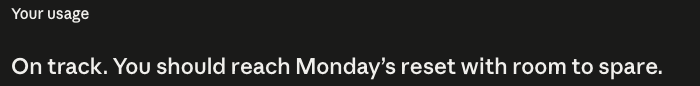

import { Tweet } from 'astro-embed';
import LinkedInPost from '@components/LinkedInPost.astro';

Helpful, I think?

---

<Tweet id="https://x.com/trq212/status/2101009392611278961" />

Wild how long this took

---

Ngrok by Cloudflare https://try.cloudflare.com/

---

<LinkedInPost id="https://www.linkedin.com/feed/update/urn:li:activity:7506712698722840576/">

Lately, I've been pulling on a ton of different project threads while experimenting with the newest models like GPT-6 Astra and Claude Fable 5.1. Now, my problem is I am out of tokens for the week with many days left to go.

It's been popular among some people to rotate between several or even scores of subscription accounts from OpenAI and Anthropic. Instead of shelling out for another account, I decided to take this as an opportunity to test-drive some of the leading open-weight models.

The quality was good, but the cost blew me away. Yes, yes, you can't just "one-shot" your way through everything like you were doing with Astra, but I was struggling to even spend a dollar with DeepSeek 4.1 Flash while getting actual work done.

Picking the right model for the job is more in style than ever. My initial anxiety about being beholden to the big labs to do most of my work is gone. Open-weight models are fantastic, incredibly cheap, and can be run on infrastructure you trust.

</LinkedInPost>
